# Build something generational

  

  <a href="https://github.com/waseemkhalo/waseemkhalo/issues/new?title=sunnyside%3A%20left&body=Press%20Create.%20Your%20result%20shows%20up%20here%20in%20about%2030%20seconds.">⬅ Launch left</a>
  &nbsp;·&nbsp;
  <a href="https://github.com/waseemkhalo/waseemkhalo/issues/new?title=sunnyside%3A%20middle&body=Press%20Create.%20Your%20result%20shows%20up%20here%20in%20about%2030%20seconds.">⬆ Launch middle</a>
  &nbsp;·&nbsp;
  <a href="https://github.com/waseemkhalo/waseemkhalo/issues/new?title=sunnyside%3A%20right&body=Press%20Create.%20Your%20result%20shows%20up%20here%20in%20about%2030%20seconds.">➡ Launch right</a>

<a href="https://eggverse.co"><b>Play on EggVerse →</b></a>

